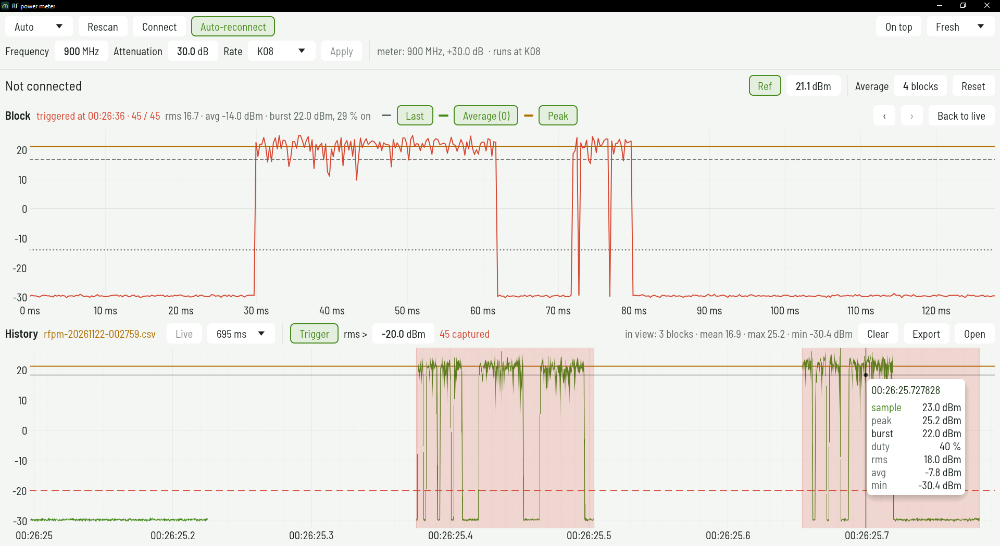

# RFdyno

Rust driver and a small viewer for the cheap USB "RF-Power-Meter-V5.0" (100 kHz to 10 GHz,
0 to -60 dBm, USB-C, aluminium box without a display).

- `crates/rfpm`: the driver. It finds the meter, reads its stream and groups the readings into
  frames with mean, min and max. It runs on Windows, Linux and macOS (`serialport`).
- `apps/rfdyno`: RFdyno, an egui viewer. It sets the meter's frequency, attenuation and sample rate,
  and shows:
  - a big readout with the power in W and a peak;
  - the block plot, showing the 500 samples of a block over time: the last block, the average
    and a peak hold, with a Hold button that freezes it; hovering shows all three at that
    moment. The shown block's RMS and plain average are given above it and drawn as dashed
    and dotted lines;
  - a scrollable history of every block from the last 30 minutes, with the mean and min–max
    band on a clock-time axis, each block at the time it was sampled (not when it arrived over
    USB). Zoomed in until the samples fit, it shows every sample instead, gaps between blocks
    included. It follows the newest block live; drag to look back, and click a block to show
    it in the block plot. Hovering a block shows its peak, its burst RMS and duty (only the
    readings within 10 dB of the peak: the power while transmitting, idle time left out), its RMS
    (the power average), the plain average of its dBm readings, and its minimum. Export saves the blocks
    in view, the trigger's captures or the whole history as CSV in an `exports` folder next to the program:
    one row per block with when its sampling started, the meter's frequency, attenuation and
    sample rate, its figures, then its 500 readings. Open (or dropping a file on the window)
    loads an export again for a look later: viewing mode, no meter and no sampling, with
    everything else working as on live data; Connect goes back to live. Clear forgets the
    history and the captures, after asking;
  - a trigger: every block whose RMS goes over a threshold is captured, marked in the history
    and kept apart from it (the last 1000), so the blocks where something happens are
    separated from the quiet ones. Switching it on or changing the threshold also picks them
    from what's already in the history, after the fact (an opened file's blocks too). While it's on, the block plot shows the last capture (‹ ›
    step through the captures, Back to live runs live until the next one, Captures goes back
    to them). Blocks of only ±99.9 dBm, the meter's "no valid reading", don't trigger.

  A reference level (Ref, next to Average) draws a solid line in both plots to compare with,
  such as a limit; unlike the trigger it captures nothing.

  On both plots, scroll zooms the time axis, Ctrl+scroll the dB axis, and a double click
  switches the dB axis between fitting the data and the meter's full range.

  A rate check shows which sample rate the time between blocks fits, and warns when that
  isn't the one sent. It reconnects by itself after an unplug or a stall and sends the settings
  again. It can stay on top of other windows. The themes
  are ChopShop's: Fresh, Graphite and Teal. On Windows it renders with Direct3D 12 (wgpu); on
  Linux and macOS with OpenGL (glow).

```bash
cargo run -p rfdyno
cargo run -p rfpm --example stream [port|auto] [MHz] [attenuation dB]   # one line per block
CFLAGS_x86_64_pc_windows_gnu=-D_WIN32_WINNT=0x0601 cargo build --release --target x86_64-pc-windows-gnu -p rfdyno
python3 tools/icon.py                          # redraw the icon (needs Pillow)
```

## Example: an nRF9160 trying to attach to LTE-M



An nRF9160 with its antenna port cabled to the meter through 30 dB of attenuation, its normal
firmware trying to attach to LTE-M; no RF test mode. It barely hears the network over the
cable, so it transmits at full power, with coverage-enhancement repetitions: long bursts of
1 ms subframes. The trigger (rms > -20 dBm) caught 45 blocks. The block plot shows the last:
a 30 ms burst at about 22 dBm (burst RMS 22.0 dBm, 29 % of the block). The history below
shows every sample, with the gaps where the meter wasn't sampling. Peaks reach 25 dBm, a few
dB over the burst RMS, as the LTE-M uplink's envelope does. The amber line is a 21.1 dBm
reference. So the nRF9160's 23 dBm (power class 3) reaches the connector: a healthy RF path.

## The protocol

The meter is an STM32F401 reading an AD8317 or AD8318 log detector (`0483:5740`, "STM32 Virtual
ComPort in FS Mode"). It streams as soon as the port is open, in blocks of 500 records behind an
`Aa` marker:

```text
Aa-59400000u-59700000u … +03600229m …
```

A record has fixed fields: the sign, dBm × 10 in 3 digits, the power as DDD.dd, and a unit
letter: `u` for µW, `m` for mW, `w` for W. The unit letter also ends the record. The meter
computes the dBm itself from its calibration for the set frequency, and includes the attenuation.

It takes three commands, each ending in CRLF and sent in a write of its own:

| Command | What it does |
|---|---|
| `A<MHz:4><±dd.d>` | Sets the frequency (which picks the calibration) and the attenuation, which the meter adds to every reading. Example: `A0830+30.0`. **Without the attenuation field (`A0010`), or with any other short `A…` such as `AT`, every reading becomes -99.9 dBm** until a full `A` command or a power cycle. |
| `Read` | The reply comes inside a block marker: `AR0830+30.0Aa`. The first `Read` after a setting is sometimes lost, so ask again after about 1.5 s. |
| `K01` … `K18` | The sample rate, from 2 µs to 16 ms between samples. The meter never reports it back, but the time between blocks shows it (see below). |

Each block is a burst: 500 samples at the set rate, then about 148 ms of sending during which
the meter doesn't sample. That 148 ms was measured on this unit; the protocol notes give ~158 ms
for a unit with a USB-UART bridge. So a block arrives every block span + 148 ms, and the rate
decides how much of the time the meter actually measures:

| Rate | Sample period | Block | Covers |
|---|---|---|---|
| K01 | 2 µs | 1 ms | 0.7 % |
| K02 | 4 µs | 2 ms | 1.3 % |
| K03 | 8 µs | 4 ms | 2.6 % |
| K04 | 16 µs | 8 ms | 5.1 % |
| K05 | 32 µs | 16 ms | 9.8 % |
| K06 | 64 µs | 32 ms | 18 % |
| K07 | 128 µs | 64 ms | 30 % |
| K08, K09 | 256 µs | 128 ms | 46 % |
| K10, K11 | 512 µs | 256 ms | 63 % |
| K12 | 1 ms | 512 ms | 78 % |
| K13 | 2 ms | 1.0 s | 87 % |
| K14, K15 | 4 ms | 2.0 s | 93 % |
| K16, K17 | 8 ms | 4.1 s | 97 % |
| K18 | 16 ms | 8.2 s | 98 % |

Bursts shorter than the gap can fall into it unseen. The viewer's rate check uses the same
interval to tell which rate the meter runs at. It can't tell K01–K04 apart (149–156 ms).

The meter pauses about 1 s after `A` and `K`. It forgets everything at power-up and starts at
1 MHz. The `rfpm` crate can only send these three commands, each checked byte for byte. Its
input is rated for 0 dBm at most and is damaged above +12 dBm, so put an attenuator in front of
an nRF91, which transmits up to +23 dBm.

The protocol notes come from <https://github.com/LostInNovo/rf-power-meter-v5-companion> and
were checked on this unit.

## Windows driver

The meter's USB descriptors have no interface association. With Windows' own driver the serial
port splits into a control half (`MI_00`) and a data half (`MI_01`), and only the data half
works. Either of these fixes it:

- **ST's Virtual COM Port driver (STSW-STM32102)**: it takes the whole device and gives one
  "STMicroelectronics Virtual COM Port (COMx)". This is what the test station uses.
- **Windows' own driver on the data half**: in Device Manager, open "STM32 Virtual ComPort in FS
  Mode" (`USB\VID_0483&PID_5740&MI_01`) and choose Update driver → Browse my computer → Let me
  pick → Ports (COM & LPT) → Microsoft → USB Serial Device. The control half stays in error
  (code 10), which does no harm.

Linux (`cdc_acm`) and macOS need nothing. `rfpm::find_ports` lists the control half last.

## Licence

The code is licensed under either of [Apache-2.0](LICENSE-APACHE) or [MIT](LICENSE-MIT), at your
option. The viewer bundles Barlow Semi Condensed under the SIL Open Font License
(`apps/rfdyno/assets/fonts/OFL-Barlow.txt`).
